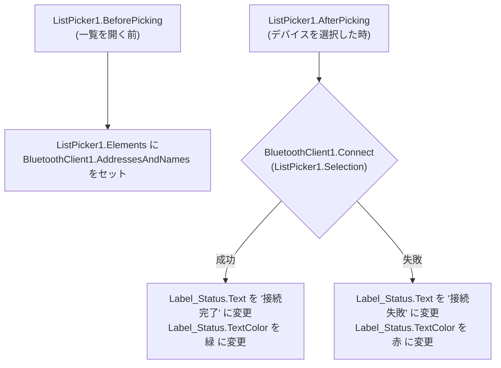

# MIT App Inventor 2 によるラジコン操作アプリ製作ガイド

参考ブログ（kenjii70氏の記事）と同様に、ブロックを組み合わせるだけでAndroid用の直感的なコントローラーアプリを作成できる **「MIT App Inventor 2」** の設計・設定手順を解説します。

---

## 1. 事前準備

1. PCのブラウザで [MIT App Inventor 2 公式サイト](https://appinventor.mit.edu/) にアクセスし、Googleアカウントでログインして新規プロジェクトを作成します（プロジェクト名: `ESP32_RC_Controller`）。
2. Androidスマートフォンに Google Play から **「MIT AI2 Companion」** アプリをインストールしておきます。

---

## 2. 画面UIデザイン（デザイナー画面）

画面左側のパレットからコンポーネントをドラッグ＆ドロップして配置します。

### 2.1 コンポーネント構成ツリー
```text
Screen1
├── HorizontalArrangement1 (ヘッダー部: 接続設定)
│   ├── ListPicker1 (テキスト: "Bluetooth接続")
│   └── Label_Status (テキスト: "未接続", テキスト色: 赤)
├── Slider_Speed (速度調整スライダー)
│   ├── MinValue: 100
│   ├── MaxValue: 255
│   └── ThumbPosition: 200
├── Label_SpeedVal (テキスト: "速度: 200")
├── TableArrangement1 (方向キー配置: 3行×3列)
│   ├── (1行目 中央) Button_Forward (テキスト: "▲ 前進")
│   ├── (2行目 左側) Button_Left    (テキスト: "◀ 左旋回")
│   ├── (2行目 中央) Button_Stop    (テキスト: "■ 停止")
│   ├── (2行目 右側) Button_Right   (テキスト: "▶ 右旋回")
│   └── (3行目 中央) Button_Reverse (テキスト: "▼ 後退")
├── BluetoothClient1 (「接続」パレットから配置 / 非可視コンポーネント)
└── Notifier1 (通知・ダイアログ用 / 非可視コンポーネント)
```

---

## 3. ブロックロジックの構築（ブロック画面）

画面右上の「ブロック」ボタンを押し、動作ロジックを組み立てます。

### 3.1 Bluetooth接続処理



#### ブロックの組み合わせ方
1. **`ListPicker1.BeforePicking`**:
   - `set ListPicker1.Elements to BluetoothClient1.AddressesAndNames`
2. **`ListPicker1.AfterPicking`**:
   - `if BluetoothClient1.Connect(address: ListPicker1.Selection) then`
     - `set Label_Status.Text to "接続完了"`
     - `set Label_Status.TextColor to [緑]`
   - `else`
     - `set Label_Status.Text to "接続失敗"`
     - `set Label_Status.TextColor to [赤]`

---

### 3.2 コマンド送信関数（共通プロシージャ）

コードをシンプルにするため、パケットフォーマット（`コマンド,左速度,右速度;`）を生成して送信する関数（手順/procedure）を作成します。

#### 手順の作成: `sendCommand(cmd)`
- 引数: `cmd`
- 処理内容:
  - `if BluetoothClient1.IsConnected then`
    - `BluetoothClient1.SendText(text:`
      - `join(`
        - `get cmd`,
        - `","`,
        - `round(Slider_Speed.ThumbPosition)`,
        - `","`,
        - `round(Slider_Speed.ThumbPosition)`,
        - `";"`
      - `)`
    - `)`

---

### 3.3 ボタン操作イベント（タッチ＆リリース制御）

ラジコンらしい操作感（**ボタンを押している間だけ動き、指を離したら自動で止まる**）を実現するため、`TouchDown` と `TouchUp` イベントを利用します。

| ボタン | イベント | 呼び出す処理 | 送信される文字列例 (速度200時) |
| :--- | :--- | :--- | :--- |
| **Button_Forward** | **TouchDown** (押した時) | `call sendCommand("a")` | `a,200,200;` |
| | **TouchUp** (離した時) | `call sendCommand("e")` | `e,200,200;` (停止) |
| **Button_Reverse** | **TouchDown** | `call sendCommand("b")` | `b,200,200;` |
| | **TouchUp** | `call sendCommand("e")` | `e,200,200;` (停止) |
| **Button_Right** | **TouchDown** | `call sendCommand("c")` | `c,200,200;` |
| | **TouchUp** | `call sendCommand("e")` | `e,200,200;` (停止) |
| **Button_Left** | **TouchDown** | `call sendCommand("d")` | `d,200,200;` |
| | **TouchUp** | `call sendCommand("e")` | `e,200,200;` (停止) |
| **Button_Stop** | **Click** (タップ時) | `call sendCommand("e")` | `e,200,200;` (即時停止) |

---

### 3.4 スライダー（速度変更）イベント

- **`Slider_Speed.PositionChanged`**:
  - `set Label_SpeedVal.Text to join("速度: ", round(Slider_Speed.ThumbPosition))`

---

## 4. アプリのテストと実機転送

### 方法1: MIT AI2 Companion でリアルタイムテスト（推奨・一番手軽）
1. PCのメニューから **「Connect」 > 「AI Companion」** をクリックし、画面にQRコードを表示させます。
2. Androidスマホの「MIT AI2 Companion」アプリを起動し、**「scan QR code」** で読み取ります。
3. 数秒でスマホ上に操作画面が表示され、リアルタイムに動作テストができます。

### 方法2: APKファイルの作成（スタンドアロンアプリ化）
1. PCのメニューから **「Build」 > 「Android App (.apk)」** をクリックします。
2. コンパイルが完了するとQRコードが表示されるので、スマホのカメラで読み取ってAPKをダウンロード＆インストールします（「提供元不明のアプリのインストール許可」が必要です）。
