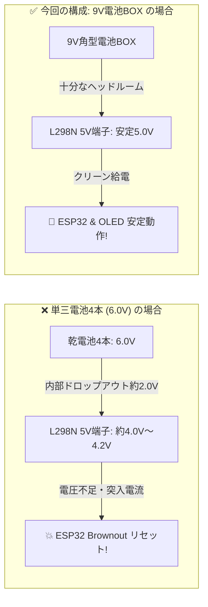

# ESP32で作るBluetoothラジコンカー
## 実機で作るスマートカー ハンズオン・ワークショップ

<div class="pt-6">
  <span class="px-3 py-1 rounded-full bg-blue-500/20 text-blue-300 border border-blue-500/30 text-sm">
    ESP32 with 0.96" OLED
  </span>
  <span class="mx-2 px-3 py-1 rounded-full bg-emerald-500/20 text-emerald-300 border border-emerald-500/30 text-sm">
    L298N Motor Driver
  </span>
  <span class="px-3 py-1 rounded-full bg-cyan-500/20 text-cyan-300 border border-cyan-500/30 text-sm">
    Next.js + shadcn/ui (Web BLE)
  </span>
</div>

<div class="abs-bottom-12 text-sm text-gray-400">
  スペースキーまたは矢印キーで次のスライドへ進みます ➔
</div>

---
layout: default
---

# 📋 本日のゴール ＆ アジェンダ

自分の手で配線・書き込みを行い、**Webブラウザから意のままに動く次世代スマートラジコンカー** を完成させます！

<div class="grid grid-cols-5 gap-3 mt-8">
  <div class="p-4 rounded-xl bg-slate-800/80 border border-slate-700 shadow-lg text-left">
    <div class="text-2xl font-bold text-blue-400">STEP 1</div>
    <div class="font-semibold mt-2 text-sm text-gray-200">構成・パーツ把握</div>
    <div class="text-xs text-gray-400 mt-2">マイコン・ドライバ・モーター・電源の役割理解</div>
  </div>
  <div class="p-4 rounded-xl bg-slate-800/80 border border-slate-700 shadow-lg text-left">
    <div class="text-2xl font-bold text-cyan-400">STEP 2</div>
    <div class="font-semibold mt-2 text-sm text-gray-200">配線ハンズオン</div>
    <div class="text-xs text-gray-400 mt-2">L298Nジャンパ設定 & GPIO信号線・電源結線</div>
  </div>
  <div class="p-4 rounded-xl bg-slate-800/80 border border-slate-700 shadow-lg text-left">
    <div class="text-2xl font-bold text-emerald-400">STEP 3</div>
    <div class="font-semibold mt-2 text-sm text-gray-200">ファーム書き込み</div>
    <div class="text-xs text-gray-400 mt-2">Arduino IDEでBLEスケッチ転送 & OLED確認</div>
  </div>
  <div class="p-4 rounded-xl bg-slate-800/80 border border-slate-700 shadow-lg text-left">
    <div class="text-2xl font-bold text-amber-400">STEP 4</div>
    <div class="font-semibold mt-2 text-sm text-gray-200">ファーストラン</div>
    <div class="text-xs text-gray-400 mt-2">Web Bluetoothペアリング & 基本走行テスト</div>
  </div>
  <div class="p-4 rounded-xl bg-slate-800/80 border border-slate-700 shadow-lg text-left">
    <div class="text-2xl font-bold text-purple-400">STEP 5</div>
    <div class="font-semibold mt-2 text-sm text-gray-200">モダンWeb UI</div>
    <div class="text-xs text-gray-400 mt-2">Next.js + shadcn/uiでコックピットUI自作</div>
  </div>
</div>

<div class="mt-8 p-3 rounded-lg bg-blue-950/40 border border-blue-800/60 text-xs text-blue-200 flex items-center gap-2">
  <span class="text-base">💡</span>
  <span>アプリのインストール不要！スマホのChromeブラウザからワンタップで操縦できる最先端Web Bluetoothスタックです！</span>
</div>

---
layout: default
---

# 🧰 使用パーツ一覧の確認

作業を始める前に、手元の部品が揃っているか確認しましょう。

<div class="grid grid-cols-2 gap-4 mt-6">
  <div class="p-4 rounded-xl bg-slate-900/90 border border-slate-800 flex gap-4 items-center">
    <div class="text-3xl">📟</div>
    <div class="text-left text-sm">
      <div class="font-bold text-blue-300">ESP32 開発ボード (OLED搭載)</div>
      <div class="text-gray-400 text-xs mt-1">オンボード 0.96" SSD1306 (I2C: SDA=21, SCL=22)</div>
      <div class="text-gray-500 text-xs">BLE (Bluetooth Low Energy) & Wi-Fi内蔵</div>
    </div>
  </div>

  <div class="p-4 rounded-xl bg-slate-900/90 border border-slate-800 flex gap-4 items-center">
    <div class="text-3xl">🎛️</div>
    <div class="text-left text-sm">
      <div class="font-bold text-red-300">L298N モータードライバー</div>
      <div class="text-gray-400 text-xs mt-1">デュアルHブリッジ、最大2A出力</div>
      <div class="text-gray-500 text-xs">PWM速度制御(ENA/ENB) & 5V降圧レギュレータ内蔵</div>
    </div>
  </div>

  <div class="p-4 rounded-xl bg-slate-900/90 border border-slate-800 flex gap-4 items-center">
    <div class="text-3xl">⚙️</div>
    <div class="text-left text-sm">
      <div class="font-bold text-amber-300">TTモーター (2基) & ホイール (2輪)</div>
      <div class="text-gray-400 text-xs mt-1">減速比 1:48 ギヤードDCモーター (200RPM)</div>
      <div class="text-gray-500 text-xs">ゴムタイヤホイール付属 (2WD車体用)</div>
    </div>
  </div>

  <div class="p-4 rounded-xl bg-slate-900/90 border border-slate-800 flex gap-4 items-center">
    <div class="text-3xl">🔋</div>
    <div class="text-left text-sm">
      <div class="font-bold text-emerald-300">9V角型電池BOX (スイッチ付) & 線材</div>
      <div class="text-gray-400 text-xs mt-1">ON/OFFスイッチ付き電池ホルダー (006P用)</div>
      <div class="text-gray-500 text-xs">オス-メス / メス-メス ジャンパーワイヤー</div>
    </div>
  </div>
</div>

---
layout: default
---

# 🏛️ システムアーキテクチャ (Archify System Map)

Archifyで生成されたインタラクティブ・システムマップです。ノードのホバー、テーマ切り替え、ルートトレース、モーション再生が直接操作できます。

<ArchifyViewer 
  src="/diagrams/esp32-rc-car.html?theme=dark&preset=signal-flow&motion=on" 
  title="ESP32 RC Car Architecture" 
/>

---
layout: default
---

# 🔧 STEP 1: L298N のジャンパ設定 (Archify Jumper Map)

モータードライバーのジャンパ設定と電源・PWM信号の接続構造です。ENA/ENBジャンパは外してPWM制御、5V-ENジャンパは装着して安定5V降圧給電を行います。

<ArchifyViewer 
  src="/diagrams/l298n-config.html?theme=dark&preset=blueprint&motion=on" 
  title="L298N Configuration Map" 
/>

---
layout: default
---

# 🔌 STEP 2: 完全配線マップ (Pinout Table)

ジャンパー線を使って、ESP32、L298N、電源、モーターを確実に接続します。

<div class="grid grid-cols-2 gap-4 mt-4 text-xs">
  <div>
    <div class="font-bold text-indigo-400 mb-1 flex items-center gap-1">
      <span>📡</span> 制御信号線 (ESP32 ➔ L298N)
    </div>
    <table class="w-full text-left border-collapse border border-slate-700">
      <thead class="bg-slate-800 text-gray-200">
        <tr><th class="p-1.5 border border-slate-700">ESP32 GPIO</th><th class="p-1.5 border border-slate-700">L298N 端子</th><th class="p-1.5 border border-slate-700">役割</th></tr>
      </thead>
      <tbody class="text-gray-300 font-mono text-[11px]">
        <tr class="bg-slate-900/50"><td class="p-1.5 border border-slate-700 font-bold text-amber-300">GPIO 14</td><td class="p-1.5 border border-slate-700">ENA</td><td>右モーター PWM速度</td></tr>
        <tr><td class="p-1.5 border border-slate-700">GPIO 27</td><td class="p-1.5 border border-slate-700">IN1</td><td>右モーター 方向1</td></tr>
        <tr class="bg-slate-900/50"><td class="p-1.5 border border-slate-700">GPIO 26</td><td class="p-1.5 border border-slate-700">IN2</td><td>右モーター 方向2</td></tr>
        <tr><td class="p-1.5 border border-slate-700">GPIO 32</td><td class="p-1.5 border border-slate-700">IN3</td><td>左モーター 方向1</td></tr>
        <tr class="bg-slate-900/50"><td class="p-1.5 border border-slate-700">GPIO 33</td><td class="p-1.5 border border-slate-700">IN4</td><td>左モーター 方向2</td></tr>
        <tr><td class="p-1.5 border border-slate-700 font-bold text-amber-300">GPIO 25</td><td class="p-1.5 border border-slate-700">ENB</td><td>左モーター PWM速度</td></tr>
      </tbody>
    </table>
  </div>

  <div>
    <div class="font-bold text-emerald-400 mb-1 flex items-center gap-1">
      <span>⚡</span> 電源 ＆ モーター接続
    </div>
    <table class="w-full text-left border-collapse border border-slate-700">
      <thead class="bg-slate-800 text-gray-200">
        <tr><th class="p-1.5 border border-slate-700">接続元</th><th class="p-1.5 border border-slate-700">接続先</th><th class="p-1.5 border border-slate-700">内容</th></tr>
      </thead>
      <tbody class="text-gray-300 font-mono text-[11px]">
        <tr class="bg-slate-900/50"><td class="p-1.5 border border-slate-700 text-red-400">9V電池BOX 赤 (+)</td><td class="p-1.5 border border-slate-700">L298N 12V端子</td><td>主電源供給</td></tr>
        <tr><td class="p-1.5 border border-slate-700 text-gray-400">9V電池BOX 黒 (-)</td><td class="p-1.5 border border-slate-700">L298N GND端子</td><td>電源GND</td></tr>
        <tr class="bg-slate-900/50"><td class="p-1.5 border border-slate-700 font-bold text-emerald-400">ESP32 GND</td><td class="p-1.5 border border-slate-700">L298N GND端子</td><td>共通GND (必須!)</td></tr>
        <tr><td class="p-1.5 border border-slate-700 text-cyan-400">L298N 5V端子</td><td class="p-1.5 border border-slate-700">ESP32 5V (VIN)</td><td>降圧5V給電</td></tr>
        <tr class="bg-slate-900/50"><td class="p-1.5 border border-slate-700">L298N OUT1/OUT2</td><td class="p-1.5 border border-slate-700">右 TTモーター</td><td>右輪出力</td></tr>
        <tr><td class="p-1.5 border border-slate-700">L298N OUT3/OUT4</td><td class="p-1.5 border border-slate-700">左 TTモーター</td><td>左輪出力</td></tr>
      </tbody>
    </table>
  </div>
</div>

---
layout: default
---

# ⚡ 電源設計の極意: なぜ9V角型電池なのか？

自作ラジコンカーで最も多い失敗は **「モーターが回った瞬間にESP32がリセットする」** トラブルです。



<div class="mt-4 p-3 rounded-xl bg-slate-900/90 border border-slate-800 text-xs text-gray-300">
  <span class="font-bold text-amber-300">💡 ワンポイントアドバイス:</span>
  もし急発進時にOLED画面が初期化画面に戻る（再起動する）場合は、006P電池の瞬間電流不足が原因です。<br/>
  その際は、<strong>ESP32側のみモバイルバッテリーからUSB給電</strong>（電源完全分離）すると絶対にリセットしなくなります。
</div>

---
layout: default
---

# 💻 STEP 3: ファームウェア構成解説

メインスケッチ `esp32_rc_car.ino` の主要機能とBLE (Nordic UART) 実装

```cpp {all|3-5|7-11|13-16}
// BLE Nordic UART Service (NUS) コールバック
class MyCallbacks: public BLECharacteristicCallbacks {
  void onWrite(BLECharacteristic *pChar) {
    std::string rx = pChar->getValue();
    parseCommandPacket(String(rx.c_str())); // "a,200,200;" を即座にパース
  }
};

// 安全機能: フェイルセーフ (通信途絶1.5秒で自動停止)
if (currentCommand != 'e' && (millis() - lastPacketTime > FAILSAFE_TIMEOUT_MS)) {
  applyMotorControl('e', 0, 0); // 暴走防止自動ブレーキ
}

// OLED画面のリアルタイム更新 (100ms周期)
if (millis() - lastDisplayTime > DISPLAY_INTERVAL_MS) {
  updateOLED(); // 左右速度バーグラフと生パケットを表示
}
```

<div class="mt-4 grid grid-cols-3 gap-2 text-xs text-left">
  <div class="p-2 rounded bg-slate-800 border border-slate-700">
    <div class="font-bold text-cyan-300">Web Bluetooth (BLE)</div>
    <div class="text-gray-400 mt-1">Nordic UART Serviceによる10〜20ms超低遅延シリアル通信</div>
  </div>
  <div class="p-2 rounded bg-slate-800 border border-slate-700">
    <div class="font-bold text-emerald-300">30kHz モーターPWM</div>
    <div class="text-gray-400 mt-1">人の可聴域（20kHz）を超える周波数で耳障りなモーターモータ音をゼロ化</div>
  </div>
  <div class="p-2 rounded bg-slate-800 border border-slate-700">
    <div class="font-bold text-amber-300">2重安全ブレーキ</div>
    <div class="text-gray-400 mt-1">PointerUp即時停止 ＋ 1.5秒タイムアウトフェイルセーフ</div>
  </div>
</div>

---
layout: default
---

# 🚀 STEP 3: ファーム書き込み ＆ OLED表示検証 (Archify Display Map)

ESP32へのスケッチ転送と、起動からOLEDテレメトリ表示・BLE待機までの画面遷移フローです。書き込み後、OLEDに初期化画面が表示され、自動的に [BLE: WAITING...] に遷移すればマイコン側の準備完了です。

<ArchifyViewer 
  src="/diagrams/oled-display.html?theme=dark&preset=signal-flow&motion=on" 
  title="ESP32 Firmware Bringup and OLED Display Lifecycle" 
/>

---
layout: default
---

# 📱 STEP 4: スマホでファーストラン！

Next.jsで構築されたWebコックピットを開いて、実機を操縦してみましょう！

<div class="grid grid-cols-3 gap-4 mt-6 text-xs text-left">
  <div class="p-4 rounded-xl bg-slate-800/80 border border-slate-700">
    <div class="text-xl font-bold text-blue-400 mb-2">1. Web UI 起動</div>
    <div class="text-gray-300">
      ターミナルで起動：<br/>
      <code>cd web-controller</code><br/>
      <code>npm run dev</code><br/>
      ブラウザで <code>http://localhost:3000</code> を開きます。
    </div>
  </div>

  <div class="p-4 rounded-xl bg-slate-800/80 border border-slate-700">
    <div class="text-xl font-bold text-emerald-400 mb-2">2. ワンタップ接続</div>
    <div class="text-gray-300">
      右上の <strong class="text-cyan-300">「接続」</strong> ボタンを押して <strong>`ESP32_RC_Car`</strong> を選択。<br/>
      車体のOLEDが <strong class="text-emerald-300">`[BLE: CONNECTED]`</strong> に変化します！
    </div>
  </div>

  <div class="p-4 rounded-xl bg-slate-800/80 border border-slate-700">
    <div class="text-xl font-bold text-amber-400 mb-2">3. 直感コントロール</div>
    <div class="text-gray-300">
      画面上の <strong>D-Pad</strong> をタッチしている間だけ前進・旋回！<br/>
      指を離すと即座に安全ブレーキがかかります。<br/>
      PCキーボード（WASD / 矢印キー）でも操作可能です！
    </div>
  </div>
</div>

<div class="mt-6 p-3 rounded-lg bg-blue-950/40 border border-blue-800 text-xs text-blue-200">
  💡 <strong>スマホからのアクセス</strong>: PCと同じWi-Fiに繋いだスマホから <code>http://[PCのIPアドレス]:3000</code> にアクセスすれば、スマホを本物の操縦プロポとして使用できます！
</div>

---
layout: default
---

# ⏱️ 制御＆安全シーケンス (Archify Sequence Map)

Webブラウザのタッチ操作（PointerDown）からWeb Bluetooth通信、モーター回転、そして指を離した時の自動停止（PointerUp）までの時系列フローです。Archifyのシーケンスビューで、通信・制御・OLED描画・安全ブレーキのライフサイクルをインタラクティブに確認できます。

<ArchifyViewer 
  src="/diagrams/rc-car-sequence.html?theme=dark&preset=signal-flow&motion=on" 
  title="ESP32 RC Car Control Sequence" 
/>

---
layout: default
---

# 🎮 STEP 5: Next.js + shadcn/ui コントローラー (Archify Web Architecture)

Next.js 14 (App Router) と shadcn/ui で構築したWebコックピットの内部アーキテクチャです。Web Bluetooth API (Nordic UART Service) を介してESP32と直結し、触覚フィードバックや非常停止（E-STOP）を備えた近未来ダッシュボードを実現しています。

<ArchifyViewer 
  src="/diagrams/web-controller.html?theme=dark&preset=signal-flow&motion=on" 
  title="Next.js & shadcn/ui Web Controller Architecture" 
/>

---
layout: default
---

# 🔍 トラブルシューティング（困ったときは？）

<div class="grid grid-cols-2 gap-4 mt-6 text-xs text-left">
  <div class="p-3.5 rounded-xl bg-slate-800/80 border border-slate-700">
    <div class="font-bold text-amber-400 text-sm mb-1">Q. ブラウザで「接続」を押してもダイアログが出ない</div>
    <div class="text-gray-300">
      <strong>A. Web Bluetooth API対応ブラウザか確認します。</strong><br/>
      Android Chrome または PC (Chrome / Edge) をご使用ください。iOS標準Safariは未対応のため、App Storeから「Bluefy」ブラウザをご利用ください。
    </div>
  </div>

  <div class="p-3.5 rounded-xl bg-slate-800/80 border border-slate-700">
    <div class="font-bold text-amber-400 text-sm mb-1">Q. 前進ボタンでタイヤが片方だけ逆回転する</div>
    <div class="text-gray-300">
      <strong>A. モーター線の極性を入れ替えます。</strong><br/>
      L298Nの端子台（OUT1/OUT2 または OUT3/OUT4）に挟んでいる2本の線を左右入れ替えるだけで回転方向が反転します。
    </div>
  </div>

  <div class="p-3.5 rounded-xl bg-slate-800/80 border border-slate-700">
    <div class="font-bold text-amber-400 text-sm mb-1">Q. モーターが動いた瞬間にESP32がリセットする</div>
    <div class="text-gray-300">
      <strong>A. 突入電流による電圧降下です。</strong><br/>
      ESP32をモバイルバッテリー等からUSB給電（電源完全分離）にするか、速度スライダーを低め（140〜160）に設定してください。
    </div>
  </div>

  <div class="p-3.5 rounded-xl bg-slate-800/80 border border-slate-700">
    <div class="font-bold text-amber-400 text-sm mb-1">Q. BLEデバイス一覧に「ESP32_RC_Car」が出ない</div>
    <div class="text-gray-300">
      <strong>A. ESP32の電源とアドバタイズ状態を確認。</strong><br/>
      PCのシリアルモニタ（115200bps）を開き、「BLE Device started: ESP32_RC_Car」が出ているか確認してください。すでに別の端末に接続中の場合は一覧に表示されません。
    </div>
  </div>
</div>

---
layout: end
class: text-center
---

# 🎉 製作完了！お疲れ様でした！

自分だけのオリジナルESP32スマートラジコンカーで、自由自在な走行を楽しみましょう！

<div class="mt-8 grid grid-cols-3 gap-4 text-xs text-left max-w-xl mx-auto">
  <div class="p-3 rounded-lg bg-slate-850 border border-slate-700">
    <div class="font-bold text-cyan-300">発展 1: PWAインストール</div>
    <div class="text-gray-400 mt-1">Webアプリをスマホのホーム画面に追加して、本物のネイティブアプリ感覚で起動！</div>
  </div>
  <div class="p-3 rounded-lg bg-slate-850 border border-slate-700">
    <div class="font-bold text-purple-300">発展 2: ESP32-CAM 映像連動</div>
    <div class="text-gray-400 mt-1">Webコックピット上部にリアルタイムカメラストリーミングを埋め込み、FPV操縦！</div>
  </div>
  <div class="p-3 rounded-lg bg-slate-850 border border-slate-700">
    <div class="font-bold text-emerald-300">発展 3: 加速度センサー操縦</div>
    <div class="text-gray-400 mt-1">スマホのジャイロ（DeviceOrientation API）と連携し、スマホを傾けてハンドル操作！</div>
  </div>
</div>

<div class="mt-8 text-xs text-gray-500">
  Webコントローラー起動: <code>cd web-controller && npm run dev</code> ｜ スライド起動: <code>npm run dev</code>
</div>
