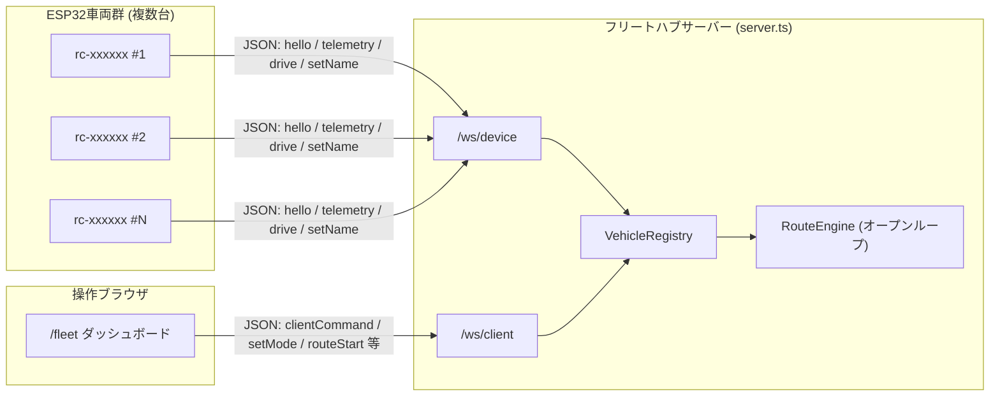

# Next.js + shadcn/ui ESP32 RC Webコックピット 操縦・開発ガイド

本ドキュメントは、**Next.js 14 (App Router)**、**shadcn/ui スタイル**、および **Web Bluetooth API** を用いた自作ESP32ラジコンカー専用Webコントローラーのセットアップと操縦方法を解説するガイドです。

専用のネイティブアプリをインストールすることなく、スマートフォン（Android Chrome、またはiOS Bluefyブラウザ）からWebページを開くだけで、ワンタップでESP32とBLE接続して直感的に操縦できます。

---

## 1. システム構成・機能一覧

```mermaid
graph LR
    subgraph Browser ["Webブラウザ (スマートフォン / PC)"]
        UI["Cyberpunk コックピット UI<br/>(D-Pad / 速度スライダー / E-STOP)"]
        BLE_Hook["useWebBluetooth フック<br/>(GATT接続 / パケット生成 / 触覚振動)"]
        UI --> BLE_Hook
    end

    subgraph Hardware ["車体側: ESP32 + L298N"]
        NUS["Nordic UART Service (NUS)<br/>UUID: 6E400001-..."]
        FW["ファームウェア (esp32_rc_car.ino)<br/>30kHz PWM / フェイルセーフ"]
        OLED["0.96\" OLED ディスプレイ<br/>リアルタイム速度メーター"]
        L298N["L298N モータードライバー"]
        Motors["TTモーター (2WD)"]

        NUS --> FW
        FW --> OLED
        FW --> L298N
        L298N --> Motors
    end

    BLE_Hook -- "Web Bluetooth (BLE 2.4GHz)<br/>パケット: a,200,200; / 周期: 15ms" --> NUS
```

### コックピットの主要機能
- **直感的なD-Pad操作**: 指でタッチ（PointerDown）している間だけ前進・旋回、指を離す（PointerUp）と瞬時に停止コマンド（`e,0,0;`）を送出。
- **触覚フィードバック (Haptics)**: ボタンタップ時や非常停止時にスマホが振動（`navigator.vibrate`）。
- **無段階スロットル調整 (Slider)**: 100〜255のPWM速度をリアルタイムに変更。クイックプリセット（SLOW / NORMAL / TURBO）搭載。
- **非常停止（E-STOP）ボタン**: 暴走の危険を感じた瞬間に一発でモーター出力をゼロにする大型停止ボタン。
- **リアルタイム・テレメトリ**: 接続状態（ONLINE/OFFLINE）、通信レイテンシ（Ping/ms）、送信パケット数、左右モーター出力インジケーター。
- **PCキーボード操作対応**: W/A/S/D、矢印キー、Spaceキー（ブレーキ）でPCからも走行可能。

---

## 2. 起動手順

### (1) ローカル開発サーバーの起動
プロジェクトルート内の `web-controller` ディレクトリに移動し、サーバーを起動します。

```powershell
cd web-controller
npm run dev
```

ターミナルに以下が表示されます：
```
  ▲ Next.js 14.2.35
  - Local:        http://localhost:3000
  - Network:      http://192.168.x.x:3000
```

### (2) スマートフォンからのアクセス
1. スマートフォンをPCと同じWi-Fiに接続します。
2. スマホのChromeブラウザを開き、ターミナルに表示された **Network URL**（例: `http://192.168.1.100:3000`）にアクセスします。
   > [!TIP]
   > Web Bluetooth APIはセキュリティ上、`localhost` または `HTTPS` 環境が必要です。ローカルIP（`http://192.168.x.x:3000`）で接続する場合は、Android Chromeの `chrome://flags/#unsafely-treat-insecure-origin-as-secure` に上記URLを登録するか、Next.jsをVercel等へデプロイしてHTTPS接続するのが最もスムーズです。

---

## 3. 車体への接続と操縦

1. **ESP32の電源投入**:
   - 9V電池BOXのスイッチをONにします。
   - オンボードOLEDに `[BLE: WAITING...]` と表示されることを確認します。
2. **Web画面で「接続」ボタンをタップ**:
   - 右上の青色 **「接続」** ボタンを押すと、ブラウザ標準のBluetoothデバイス選択ダイアログが表示されます。
   - 一覧から **`ESP32_RC_Car`** を選択し、「ペアリング」を押します。
3. **接続完了の確認**:
   - 車体のOLEDが `[BLE: CONNECTED]` に変化し、Web画面のSTATUSが `ONLINE` に変わります。
4. **走行コントロール**:
   - **▲ 前進**: 押下中に前進（`a,speed,speed;`）
   - **◀ 左超信地旋回**: 押下中に左旋回（`d,speed,speed;`）
   - **▶ 右超信地旋回**: 押下中に右旋回（`c,speed,speed;`）
   - **▼ 後退**: 押下中に後退（`b,speed,speed;`）
   - **⏹ BRAKE / 指を離す**: 即座に停止（`e,0,0;`）

---

## 4. プロトコル仕様 (Nordic UART Service)

Web Bluetooth APIでは、標準的なNordic UART Service (NUS) プロファイルを使用して文字列パケットを送受信します。

| パラメータ | UUID / 設定値 | 内容 |
| :--- | :--- | :--- |
| **Service UUID** | `6e400001-b5a3-f393-e0a9-e50e24dcca9e` | Nordic UART Service |
| **RX Characteristic** | `6e400002-b5a3-f393-e0a9-e50e24dcca9e` | Web ➔ ESP32 制御パケット送信 (Write Without Response) |
| **TX Characteristic** | `6e400003-b5a3-f393-e0a9-e50e24dcca9e` | ESP32 ➔ Web テレメトリ通知 (Notify) |

### 送信パケットフォーマット
```
[コマンド],[左モーターPWM],[右モーターPWM];
```
- 例: `a,190,190;`（前進、速度190）
- 例: `e,0,0;`（即時全停止）

---

## 5. フリート管理ダッシュボード (WebSocket群制御)

`v2` より、Web Bluetoothによる単機操縦(このガイドの1〜4章)に加え、複数台を同時制御する **フリートダッシュボード** を追加しました。単機コックピットは「レガシー/デバッグ用フォールバック」として維持されています。

### 5.1 起動方法
```powershell
cd web-controller
npm install
npm run dev
```
`npm run dev` は `next dev` ではなく、WebSocketハブを内蔵したカスタムサーバー（`server.ts`）を起動します。ブラウザで以下にアクセスします。
- `http://localhost:3000/` : 単機コックピット（Web Bluetooth、レガシー）
- `http://localhost:3000/fleet` : フリートダッシュボード（WebSocket）

### 5.2 通信構成


### 5.3 疑似デバイスでの動作確認
実機を用意できない場合、以下のコマンドで複数の疑似ESP32クライアントを起動して検証できます。
```powershell
npm run sim:device -- rc-car1 "Car1"
npm run sim:device -- rc-car2 "Car2"
```

### 5.4 主な操作
- **個別制御（初期状態）**: 一覧のロボットを選択すると、その名前・IDと専用の操作領域が表示されます。名前・IDで検索できます。スマホでは一覧を横スクロールできます。
- **表示設定・テーマ**: 上部ナビゲーションの「表示設定」（スマホでは調整アイコン）からライト / ダーク / OS連動を選択します。テーマ・色・アニメーションの設定を同じページに集約し、独立したテーマ切り替えボタンは置いていません。初回はOSの配色設定に合わせ、その後は保存した選択を優先します。設定ページへ移動すると走行画面は終了し、戻った際に車両選択・速度などが初期化されます。
- **走行**: 十字キーを押している間だけ走行し、離すと停止します。ボタンをフォーカスして `Enter` / `Space` を押すキーボード操作にも対応します。速度はスライダーで調整します。
- **複数制御**: 「複数制御」へ切り替えて対象をチェックします。「接続中を全選択」でまとめて選択できます。選択した全台がオンラインかつ手動モードのときだけ走行できます。
- **全台停止**: 上部の赤いボタンで自動ルートを停止し、手動モードの全オンライン車両にも停止を送信します。スマホではヘッダーがスクロール時も残ります。
- **手動 / 自動切り替え**: 選択車両の制御モードを切り替えます。`auto` の車両はルートエンジンの制御対象になり、手動走行は無効になります。自動へ切り替える直前にも停止を送信します。
- **ディスプレイ設定・カメラ**: 補助操作は折りたたみ内に整理しています。表情・画面レイアウトは選択対象へ送信します。カメラ操作はカメラ搭載車両でのみ有効です（現在のTFT搭載車両にはカメラはありません）。設定の送信と実機での反映確認は別です。
- **ルート実行**: `web-controller/fleet/routes/*.json` に定義された時間ベース(オープンループ)の走行プログラムを、`auto`モードの車両に対して開始/停止できます（例: `rendezvous-demo` = 集合→解散デモ）。

> 現時点では位置情報を用いた閉ループ制御（カメラ+ARマーカー等による実測位置トラッキング）は未実装です。`VehicleState.position` フィールドは将来拡張用に予約されています。

### 5.5 UI/UX監査と改善（2026-10-09）

[Impeccable](https://github.com/pbakaus/impeccable) の Operate / craft-floor 指針を参照し、操作画面としての情報階層、認知負荷、状態表示、タッチ領域を見直しました。操作フローのレビューと自動検査は別々に実施しています。

| 優先度 | 旧画面の欠点 | 対応 |
| --- | --- | --- |
| P1 | 全車両操作が最上部にあり、1台を選んでもチェックボックスと別の操作列を追う必要がある | 個別制御を初期状態にし、一覧と固定位置の操作領域を分離。選択対象の名前・IDを常に表示 |
| P1 | 横並びの方向ボタンが空間的な方向と一致せず、全台・選択対象の操作列も重複 | 走行操作を1つの十字キーへ統合。複数操作は明示的なモードに限定 |
| P1 | 接続状態にかかわらず一括走行が可能で、画面のフォーカス喪失にも停止処理がない | 未接続・未選択・自動モードで走行を無効化。対象変更、押下解除、キャンセル、フォーカス喪失、画面非表示時に元の対象へ停止送信 |
| P2 | 車両ごとに16個の絵文字付き表情ボタンが並び、主要操作と補助操作が競合 | 絵文字を撤去し、Lucideアイコンに統一。表情を送信用メニュー、補助設定を折りたたみに変更 |
| P2 | 暗色カード、色付き枠、小さい等幅文字が画面全体を占め、役割の違いが不明瞭 | 明色のフラットな作業領域、通常の日本語書体、選択・走行の緑と全台停止の赤に整理 |
| P2 | スマホの一覧が走行操作を下へ押し出し、小さいボタンが密集 | 個別一覧を横スクロールに変更。十字キー80px、一般ボタン・速度スライダー44px以上、停止ヘッダー固定 |

初回の外観調整では、操作部品の配置を維持し、参考画像に合わせたライト／ダークの半透明レイヤー、細い輪郭と陰影を導入しました。ライトは淡い青・ピンクの背景と青アクセント、ダークはチャコール系の背景と低彩度のアクセントです。320 / 390 / 768 / 1440px幅でテーマ切り替え前後の既存操作部品の座標一致、横はみ出しなし、保存設定の復元、操作モード・速度・検索文字列の保持を確認しました。

検証結果:
- TypeScriptチェック成功。Impeccable CLI 4.1.0のソース検査（TSXおよびCSS、設定による抑制なし）で指摘0件。ソース検査は実際の描画品質やアクセシビリティ全体の保証ではありません。
- 専用ハブと2台の模擬車両で、個別送信の分離、複数送信、押下中の継続送信、ボタン外での解除、キーボード解除、対象変更、フォーカス喪失、切断時の操作無効化を確認。
- 名前・ID検索、モード変更、自動ルート開始・全台停止、選択対象だけへの表情・レイアウト送信、オフライン車両の選択解除を確認。
- Playwrightで320 / 390 / 768 / 1440px幅のページ全体の横はみ出しなし。デスクトップとスマホのスクリーンショットを目視確認。
- 実機でのモーター動作・カメラ・通信断時の物理的停止は未検証。ネットワーク断時はUIから停止を届けられないため、実機側フェイルセーフが必要です。複数クライアント間の操作権排他は今回の対象外です。

### 5.6 Glassmorphismと表示設定

上部ナビゲーションの「表示設定」から `/fleet/settings` を開きます。設定はブラウザー単位で自動保存され、通信先や実機の制御条件は変更しません。設定ページへ移動すると走行画面は終了するため、対象・速度などの走行画面内の状態は戻った際に初期化されます。

- テーマ: ライト / ダーク / OS連動。OS連動では配色設定の変更にも追従します。
- ベースカラー: Ocean Blue / Lavender Purple / Mint Green / Rose Pink / Sunset Amber。各色に対応する3色グラデーションと明るいトーンのアクセントを生成します。
- アニメーション: オン / オフ。OSの「動きを減らす」設定はオンを選んだ場合も優先します。
- 初期設定に戻す: Ocean Blue、OS連動、アニメーションオンに戻します。
- 保存先: `fleet-appearance`。以前の `fleet-theme` の選択も初回読み込み時に引き継ぎます。保存不可の環境では適用のみ行い、設定ページに保存できなかったことを表示します。

ガラス仕様:
- 未選択を含む対象見出し・状態表示・車両・走行・設定・ルート・表示設定に共通のガラスカードを使用します。
- 「操作対象未選択」は対象見出しカード内の黄・琥珀系の警告バッジに表示し、独立した注意カードは出しません。未接続や手動モードへの切り替えが必要な場合は、警告アイコン付きの注意カードを使います。対象見出しの補助文には選択済みの名前・IDだけを表示します。
- カードの膜の不透明度: ライト約3 / 8 / 6%、ダーク約6 / 4 / 10%の勾配。淡い反射光・微細な粒子・光の偏った輪郭・陰影・角丸8pxで面を表現し、背景の形を残す6pxのぼかしを使用します。彩度は100%で重ね合わせによる過剰な色の増幅を避けます。
- ヘッダー: 約8%の膜、ぼかし6px。サイドバー: 中央約4%の膜と共通の透明度勾配、ぼかし6px。
- 入力欄・ghostボタン: 約6%の膜、ぼかし4px。選択カードは濃い塗りを追加せず、アクセントの輪郭とチェックで区別します。ネイティブの選択肢と緊急停止ボタンは読みやすさを優先します。
- 背景は選択色と第二色を透過させた折り曲面のPNGです。`web-controller/scripts/generate-glass-background.ps1`で背景と粒子を再生成できます。参照した[KMP Glassmorphismスキル](https://github.com/Aks-4125/kmp-glassmorphism-skill)の透明度勾配・反射光・輪郭の原則をWeb向けに実装しています。
- フォントはYu Gothic先頭の標準セット。24px（ページ見出し・数値）、20px（操作対象）、16px（カード見出し）、14px（本文・操作）、12px（補助情報）の役割トークンを両画面で共有します。IDと色コードのみConsolasを使います。
- 余白は4px刻み、カード内20px、カード間16px、一覧と操作領域の間24px。ガラス枠をカードの実寸内へ収めて各列の端を揃えます。操作内はデスクトップで等幅2列、1050px以下で1列、700px以下で一覧も1列になります。スマホの上部ナビゲーションは2段で、全台停止を常に右端に配置します。ホバーによる移動は行いません。
- 十字キーは最大256pxの正方形、各方向は最大80px。狭いカード内では均等に縮小し、検査した最小320px幅でも44px以上の操作領域を確保します。
- `backdrop-filter` / `-webkit-backdrop-filter` を指定し、非対応環境では半透明背景・輪郭・陰影を残します。

検証:
- 設定の保存・復元、全5色の反映、OS連動、アニメーション抑制、保存不可時の適用をブラウザーで確認。
- 再監査でImpeccableのcontext / layout / typeset / polish指針を適用し、変更したTSX・CSSの機械検査は指摘0件。TypeScriptチェックも成功。機械検査と実画面の確認は別に実施しています。
- フリートは320 / 390 / 700 / 701 / 768 / 1050 / 1051 / 1440px幅、表示設定は320 / 390 / 768 / 1440px幅で横はみ出しなし、表示中のボタン・リンクは44px以上。カード枠の端、8px角丸、文字の役割を確認し、デスクトップ・スマホの描画を目視確認。
- 実ハンドシェイクを利用し、UIに届く車両状態だけを模擬値へ置換。長い車両名、単体・複数選択、展開した補助設定を4画面幅で検査しました。前進128・停止0の送受信記録と、設定へ移動した際の停止、テーマ設定が戻った画面へ反映されることを確認。命令は捕捉のみで実ハブへ転送せず、検査後に保存済みの外観設定を復元しています。
- `npm --prefix web-controller run test:appearance` で全5色×両テーマを検査。グラデーション各区間を101点ずつサンプリングし、背景の透過色・ガラスの勾配・反射光・粒子の上下限を合成した背景色に対する本文・補助文字・アクセント文字の最低コントラストは4.74:1。これは配色モデルの検査であり、画面全体のWCAG適合認証ではありません。

