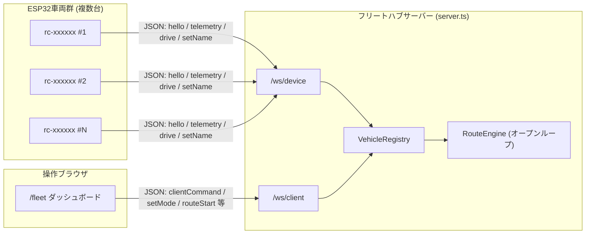

# Next.js + shadcn/ui ESP32 RC Webコックピット 操縦・開発ガイド

本ドキュメントは、**Next.js 14 (App Router)**、**shadcn/ui スタイル**、および **Web Bluetooth API** を用いた自作ESP32ラジコンカー専用Webコントローラーのセットアップと操縦方法を解説するガイドです。

専用のネイティブアプリをインストールすることなく、スマートフォン（Android Chrome、またはiOS Bluefyブラウザ）からWebページを開くだけで、ワンタップでESP32とBLE接続して直感的に操縦できます。

---

## 1. システム構成・機能一覧

```mermaid
graph LR
    subgraph Browser ["Webブラウザ (スマートフォン / PC)"]
        UI["Cyberpunk コックピット UI<br/>(D-Pad / 速度スライダー / E-STOP)"]
        BLE_Hook["useWebBluetooth フック<br/>(GATT接続 / パケット生成 / 触覚振動)"]
        UI --> BLE_Hook
    end

    subgraph Hardware ["車体側: ESP32 + L298N"]
        NUS["Nordic UART Service (NUS)<br/>UUID: 6E400001-..."]
        FW["ファームウェア (esp32_rc_car.ino)<br/>30kHz PWM / フェイルセーフ"]
        OLED["0.96\" OLED ディスプレイ<br/>リアルタイム速度メーター"]
        L298N["L298N モータードライバー"]
        Motors["TTモーター (2WD)"]

        NUS --> FW
        FW --> OLED
        FW --> L298N
        L298N --> Motors
    end

    BLE_Hook -- "Web Bluetooth (BLE 2.4GHz)<br/>パケット: a,200,200; / 周期: 15ms" --> NUS
```

### コックピットの主要機能
- **直感的なD-Pad操作**: 指でタッチ（PointerDown）している間だけ前進・旋回、指を離す（PointerUp）と瞬時に停止コマンド（`e,0,0;`）を送出。
- **触覚フィードバック (Haptics)**: ボタンタップ時や非常停止時にスマホが振動（`navigator.vibrate`）。
- **無段階スロットル調整 (Slider)**: 100〜255のPWM速度をリアルタイムに変更。クイックプリセット（SLOW / NORMAL / TURBO）搭載。
- **非常停止（E-STOP）ボタン**: 暴走の危険を感じた瞬間に一発でモーター出力をゼロにする大型停止ボタン。
- **リアルタイム・テレメトリ**: 接続状態（ONLINE/OFFLINE）、通信レイテンシ（Ping/ms）、送信パケット数、左右モーター出力インジケーター。
- **PCキーボード操作対応**: W/A/S/D、矢印キー、Spaceキー（ブレーキ）でPCからも走行可能。

---

## 2. 起動手順

### (1) ローカル開発サーバーの起動
プロジェクトルート内の `web-controller` ディレクトリに移動し、サーバーを起動します。

```powershell
cd web-controller
npm run dev
```

ターミナルに以下が表示されます：
```
  ▲ Next.js 14.2.35
  - Local:        http://localhost:3000
  - Network:      http://192.168.x.x:3000
```

### (2) スマートフォンからのアクセス
1. スマートフォンをPCと同じWi-Fiに接続します。
2. スマホのChromeブラウザを開き、ターミナルに表示された **Network URL**（例: `http://192.168.1.100:3000`）にアクセスします。
   > [!TIP]
   > Web Bluetooth APIはセキュリティ上、`localhost` または `HTTPS` 環境が必要です。ローカルIP（`http://192.168.x.x:3000`）で接続する場合は、Android Chromeの `chrome://flags/#unsafely-treat-insecure-origin-as-secure` に上記URLを登録するか、Next.jsをVercel等へデプロイしてHTTPS接続するのが最もスムーズです。

---

## 3. 車体への接続と操縦

1. **ESP32の電源投入**:
   - 9V電池BOXのスイッチをONにします。
   - オンボードOLEDに `[BLE: WAITING...]` と表示されることを確認します。
2. **Web画面で「接続」ボタンをタップ**:
   - 右上の青色 **「接続」** ボタンを押すと、ブラウザ標準のBluetoothデバイス選択ダイアログが表示されます。
   - 一覧から **`ESP32_RC_Car`** を選択し、「ペアリング」を押します。
3. **接続完了の確認**:
   - 車体のOLEDが `[BLE: CONNECTED]` に変化し、Web画面のSTATUSが `ONLINE` に変わります。
4. **走行コントロール**:
   - **▲ 前進**: 押下中に前進（`a,speed,speed;`）
   - **◀ 左超信地旋回**: 押下中に左旋回（`d,speed,speed;`）
   - **▶ 右超信地旋回**: 押下中に右旋回（`c,speed,speed;`）
   - **▼ 後退**: 押下中に後退（`b,speed,speed;`）
   - **⏹ BRAKE / 指を離す**: 即座に停止（`e,0,0;`）

---

## 4. プロトコル仕様 (Nordic UART Service)

Web Bluetooth APIでは、標準的なNordic UART Service (NUS) プロファイルを使用して文字列パケットを送受信します。

| パラメータ | UUID / 設定値 | 内容 |
| :--- | :--- | :--- |
| **Service UUID** | `6e400001-b5a3-f393-e0a9-e50e24dcca9e` | Nordic UART Service |
| **RX Characteristic** | `6e400002-b5a3-f393-e0a9-e50e24dcca9e` | Web ➔ ESP32 制御パケット送信 (Write Without Response) |
| **TX Characteristic** | `6e400003-b5a3-f393-e0a9-e50e24dcca9e` | ESP32 ➔ Web テレメトリ通知 (Notify) |

### 送信パケットフォーマット
```
[コマンド],[左モーターPWM],[右モーターPWM];
```
- 例: `a,190,190;`（前進、速度190）
- 例: `e,0,0;`（即時全停止）

---

## 5. フリート管理ダッシュボード (WebSocket群制御)

`v2` より、Web Bluetoothによる単機操縦(このガイドの1〜4章)に加え、複数台を同時制御する **フリートダッシュボード** を追加しました。単機コックピットは「レガシー/デバッグ用フォールバック」として維持されています。

### 5.1 起動方法
```powershell
cd web-controller
npm install
npm run dev
```
`npm run dev` は `next dev` ではなく、WebSocketハブを内蔵したカスタムサーバー（`server.ts`）を起動します。ブラウザで以下にアクセスします。
- `http://localhost:3000/` : 単機コックピット（Web Bluetooth、レガシー）
- `http://localhost:3000/fleet` : フリートダッシュボード（WebSocket）

### 5.2 通信構成


### 5.3 疑似デバイスでの動作確認
実機を用意できない場合、以下のコマンドで複数の疑似ESP32クライアントを起動して検証できます。
```powershell
npm run sim:device -- rc-car1 "Car1"
npm run sim:device -- rc-car2 "Car2"
```

### 5.4 主な操作
- **一括操作**: 全オンライン車両へ同一コマンドを一斉送信。
- **個別選択操作**: チェックボックスで選択した車両にのみコマンドを送信。
- **manual / auto 切り替え**: `auto` の車両はルートエンジンの制御対象になり、手動コマンドは無視されます（衝突防止）。
- **ルート実行**: `web-controller/fleet/routes/*.json` に定義された時間ベース(オープンループ)の走行プログラムを、`auto`モードの車両に対して開始/停止できます（例: `rendezvous-demo` = 集合→解散デモ）。

> 現時点では位置情報を用いた閉ループ制御（カメラ+ARマーカー等による実測位置トラッキング）は未実装です。`VehicleState.position` フィールドは将来拡張用に予約されています。

